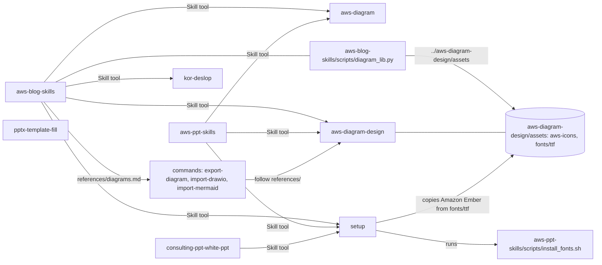
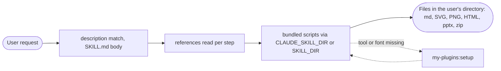

# Architecture

---

# English

## System Overview
`my-plugins` is one Claude Code plugin that bundles four earlier plugins by WooHyung Choi: aws-blog-skills
1.2.2, aws-diagrams 1.0.0, kor-writing 1.0.0 and aws-deck 1.0.0. It ships eight skills and three slash
commands. Each skill is Markdown instructions plus bundled Python, Bash or Node.js scripts that Claude runs on
the user's machine when the workflow calls for them. Skills call each other inside the plugin with the Skill
tool as `my-plugins:<skill>`, and reach each other's files only by paths relative to their own folder.
Output goes to the user's current directory, never into the plugin cache.

## Components

### Distribution Layer
- `.claude-plugin/marketplace.json` — marketplace `my-plugins` with one plugin entry, `"source": "./"`
- `.claude-plugin/plugin.json` — name, `version` (the update key for installed copies) and `license: MIT`;
  upstream parts and bundled templates, fonts and icons keep their own terms, see `NOTICE.md`
- GitHub `whchoi98/my-plugins` (public repo) — installers get the repo root in
  `~/.claude/plugins/cache/my-plugins/my-plugins/<version>/` and call skills as `/my-plugins:<skill>`

### AI/ML Layer: skills and commands
| Skill / command | Source | Role |
|---|---|---|
| `aws-blog-skills` | aws-blog-skills 1.2.2 | AWS Korea Tech Blog draft from source to zip, steps 0-7, references per step |
| `aws-diagram` | aws-diagrams 1.0.0 | AWS architecture SVG with the official AWS and Bedrock AgentCore icon bundle |
| `aws-diagram-design` | aws-diagrams 1.0.0 | Structure diagrams (27 visual types) as HTML/SVG/PNG; holds the shared `assets/` |
| `kor-deslop` | kor-writing 1.0.0 | Korean AI-tell removal in one pass from a 79-pattern rulebook, content unchanged |
| `aws-ppt-skills` | aws-deck 1.0.0 | Seminar decks on the bundled 2026 black or white template with pptxgenjs |
| `consulting-ppt-white-ppt` | aws-deck 1.0.0 | Dense, light consulting-report decks with a customer brand accent |
| `pptx-template-fill` | aws-deck 1.0.0 | Fills a user-supplied .pptx in place with python-pptx |
| `setup` | new | Checks and installs the external tools and fonts the other skills need |
| `commands/export-diagram.md`, `import-drawio.md`, `import-mermaid.md` | aws-diagrams 1.0.0 | Thin prompts that follow `skills/aws-diagram-design/references/` |

### Processing Layer: bundled scripts
- aws-blog-skills — `lint_prose.py`, `check_structure.py`, `check_urls.py`, `diagram_lib.py` +
  `example_diagrams.py`, `render_diagrams.py` (Playwright), `package_blog.sh`
- aws-diagram — `find_icon.py`, `embed.py` (inline icons as base64), `build_bundle.py` (maintainer)
- aws-diagram-design — `self_check.py`, `verify-geometry.py`, `drawio_extract.py`, `mermaid_extract.py`,
  `build_aws_icons.py` (maintainer)
- aws-ppt-skills — `apply_template.py`, `check_deck.py`, `svg_to_png.py`, `install_fonts.sh`
- consulting-ppt-white-ppt — `lib/consult_helpers.js`, `tools/extract_brand_color.py`, `fix_pptx.py`, `fix_notes.py`
- pptx-template-fill — `tfill.py`, `inventory.py`, `swap_font.py`, `qa_check.py`, `example_fill.py`
- setup — `scripts/setup.sh` (check, `install`, `install --sudo`)

### Dependency Layer
- `skills/setup/scripts/setup.sh` checks uv, Playwright Chromium, Amazon Ember, Noto Sans CJK KR,
  NanumSquareOTF, D2Coding, pptxgenjs, python-pptx, lxml, Pillow, cairosvg, LibreOffice, Poppler and
  rsvg-convert, and installs them into the user's home; system packages only with `--sudo`, through `sudo -n`
  ([runbook](runbooks/setup-dependencies.md))

### Security Layer
- `.claude/settings.json` deny list and empty attribution; `.claude/hooks/secret-scan.sh` (PreToolUse, exit 2)
- git `pre-commit` and `commit-msg` hooks from `scripts/install-hooks.sh`
- No hooks, agents, MCP servers or `bin/` ship at the root; `.mcp.json` stays empty
- aws-blog-skills step 0 treats source material and fetched pages as data, not instructions

### Quality Layer
- `tests/run-all.sh` with hook, secret-pattern, structure and shipped-script suites
- `claude plugin validate .`; `scripts/diagrams/` holds the aws-diagrams repo gates and fixtures

## Cross-Skill Calls

`kor-deslop` and `pptx-template-fill` call no other skill. `setup` reaches the two sibling folders through
`$SKILLS/aws-diagram-design/assets/fonts/ttf` and `$SKILLS/aws-ppt-skills/scripts/install_fonts.sh`, where
`$SKILLS` is two levels above its own script. Renaming or moving a skill breaks these links
(`skills/CLAUDE.md`).

## Diagram Asset Lookup
`find_assets()` in `skills/aws-blog-skills/scripts/diagram_lib.py` returns the first candidate that contains
`aws-icons/`:

1. `AWS_DIAGRAM_ASSETS` environment variable
2. `.aws-diagram-assets` next to the running `diagram_lib.py`. SKILL.md step 4 writes this pointer with
   `diagram_lib.py --assets` when it copies the library into `<workdir>/diagrams/`, because the copy no longer
   sits next to the sibling skill
3. The sibling skill `../../aws-diagram-design/assets`, relative to the script
4. Claude Code plugin caches `~/.claude/plugins/cache/*/my-plugins/*/skills/aws-diagram-design/assets`, then the
   same path for the old standalone `aws-diagrams`, each sorted by numeric version, newest first
5. claude.ai-synced copies `~/.claude/plugins/synced/*/*/skills/aws-diagram-design/assets` under the user's home
   and `/root`, newest modification first
6. claude.ai container paths `/mnt/skills/plugin-files/{my-plugins,aws-diagrams}/skills/aws-diagram-design/assets`

If none matches, it raises `FileNotFoundError` and asks for `AWS_DIAGRAM_ASSETS`.

## Data Flow Summary

## Packaging

| Path | Ships to installers | Loaded as plugin component | Notes |
|---|---|---|---|
| `.claude-plugin/` | yes | yes | Manifests |
| `skills/<name>/` (8 skills) | yes | yes | Description always, body and references on invoke |
| `commands/` | yes | yes | Three Markdown prompts; the only root component directory |
| `.mcp.json` | yes | yes | Must stay `{"mcpServers": {}}` |
| `skills/CLAUDE.md` | yes | no | Module doc, outside any skill folder |
| `third_party/`, `LICENSE`, `NOTICE.md`, `README.md`, `CHANGELOG.md` | yes | no | Licenses and docs |
| `.claude/` | yes | no | Dev harness, active only when this repo is the working directory |
| `docs/`, `docs/diagrams/`, `scripts/`, `tests/`, `CLAUDE.md` | yes | no | Inert for installers |

The installed copy is about 26 MB, mostly the aws-ppt-skills templates and fonts (about 15 MB) and the
aws-diagram-design and aws-diagram icons and fonts (about 9 MB).

## Key Design Decisions
- **One plugin, one namespace** — four plugins merged so cross-skill calls resolve inside one install
  ([ADR-002](decisions/ADR-002-merge-four-plugins-into-one.md)).
- **Sibling-relative paths** — a skill reaches another skill's files by `../<skill>/...`; plugin-cache globs are
  only a fallback ([ADR-002](decisions/ADR-002-merge-four-plugins-into-one.md)).
- **Dependencies through `setup`** — one script checks and installs every external tool and font; sudo only on
  request ([runbook](runbooks/setup-dependencies.md)).
- **aws-blog-skills targets Claude Code** — `${CLAUDE_SKILL_DIR}` paths, a work folder, checks on the assembled
  bundle ([ADR-001](decisions/ADR-001-claude-code-skill-conventions.md)).
- **Scripts for mechanical rules** — banned words, structure, URLs, diagram geometry and deck lint are scripts
  with exit codes; the model keeps judgment calls.

## Operations
- Release: [docs/runbooks/release-plugin.md](runbooks/release-plugin.md)
- User dependencies: [docs/runbooks/setup-dependencies.md](runbooks/setup-dependencies.md)
- Onboarding: [docs/onboarding.md](onboarding.md)

---

# 한국어

## 시스템 개요
`my-plugins`는 WooHyung Choi의 플러그인 네 개(aws-blog-skills 1.2.2, aws-diagrams 1.0.0, kor-writing 1.0.0, aws-deck 1.0.0)를 묶은 Claude Code 플러그인 하나입니다. skill 8개와 슬래시 command 3개를 배포합니다. 각 skill은 Markdown 지침과 함께 배포되는 Python, Bash, Node.js 스크립트로 이루어지며, 워크플로가 필요로 할 때 Claude가 사용자 머신에서 스크립트를 실행합니다. skill끼리는 플러그인 안에서 Skill 도구로 `my-plugins:<skill>`을 부르고, 다른 skill의 파일은 자기 폴더 기준 상대 경로로만 찾습니다. 결과물은 사용자의 현재 디렉터리에 만들며 플러그인 캐시에는 쓰지 않습니다.

## 구성 요소

### Distribution Layer
- `.claude-plugin/marketplace.json` — 마켓플레이스 `my-plugins`, 플러그인 항목 하나, `"source": "./"`
- `.claude-plugin/plugin.json` — 이름과 `version`(설치본 갱신 기준). `license`는 MIT이고, 원 저작물과 함께 든 템플릿, 폰트, 아이콘은 각자의 조건을 따릅니다(`NOTICE.md` 참고)
- GitHub `whchoi98/my-plugins`(공개 저장소) — 설치하면 저장소 루트가 `~/.claude/plugins/cache/my-plugins/my-plugins/<version>/`에 들어가고, skill은 `/my-plugins:<skill>`로 부릅니다

### AI/ML Layer: skill과 command
| skill / command | 출처 | 역할 |
|---|---|---|
| `aws-blog-skills` | aws-blog-skills 1.2.2 | 소재부터 zip까지 AWS Korea Tech Blog 원고. 0~7단계, 단계별 참조 파일 |
| `aws-diagram` | aws-diagrams 1.0.0 | 공식 AWS 아이콘과 Bedrock AgentCore 아이콘 묶음으로 그리는 AWS 아키텍처 SVG |
| `aws-diagram-design` | aws-diagrams 1.0.0 | 구조 다이어그램(시각 유형 27가지) HTML/SVG/PNG. 공용 `assets/`를 가짐 |
| `kor-deslop` | kor-writing 1.0.0 | 패턴 79개 규칙집으로 한국어 AI 티를 한 번에 제거. 내용은 그대로 |
| `aws-ppt-skills` | aws-deck 1.0.0 | 포함된 2026 블랙·화이트 템플릿 위에 pptxgenjs로 만드는 세미나 덱 |
| `consulting-ppt-white-ppt` | aws-deck 1.0.0 | 고객 브랜드 색을 쓰는 밝은 고밀도 컨설팅 리포트 덱 |
| `pptx-template-fill` | aws-deck 1.0.0 | 사용자가 준 .pptx를 python-pptx로 제자리에서 채우기 |
| `setup` | 신규 | 다른 skill이 쓰는 외부 프로그램과 폰트 점검·설치 |
| `commands/export-diagram.md`, `import-drawio.md`, `import-mermaid.md` | aws-diagrams 1.0.0 | `skills/aws-diagram-design/references/`를 따르는 짧은 프롬프트 |

### Processing Layer: 함께 배포되는 스크립트
- aws-blog-skills — `lint_prose.py`, `check_structure.py`, `check_urls.py`, `diagram_lib.py` + `example_diagrams.py`, `render_diagrams.py`(Playwright), `package_blog.sh`
- aws-diagram — `find_icon.py`, `embed.py`(아이콘을 base64로 내장), `build_bundle.py`(관리자용)
- aws-diagram-design — `self_check.py`, `verify-geometry.py`, `drawio_extract.py`, `mermaid_extract.py`, `build_aws_icons.py`(관리자용)
- aws-ppt-skills — `apply_template.py`, `check_deck.py`, `svg_to_png.py`, `install_fonts.sh`
- consulting-ppt-white-ppt — `lib/consult_helpers.js`, `tools/extract_brand_color.py`, `fix_pptx.py`, `fix_notes.py`
- pptx-template-fill — `tfill.py`, `inventory.py`, `swap_font.py`, `qa_check.py`, `example_fill.py`
- setup — `scripts/setup.sh`(점검, `install`, `install --sudo`)

### Dependency Layer
- `skills/setup/scripts/setup.sh`가 uv, Playwright Chromium, Amazon Ember, Noto Sans CJK KR, NanumSquareOTF, D2Coding, pptxgenjs, python-pptx, lxml, Pillow, cairosvg, LibreOffice, Poppler, rsvg-convert를 점검하고 사용자 홈에 설치합니다. 시스템 패키지는 `--sudo`를 줄 때만 `sudo -n`으로 설치합니다([런북](runbooks/setup-dependencies.md))

### Security Layer
- `.claude/settings.json` deny 목록과 비운 attribution, `.claude/hooks/secret-scan.sh`(PreToolUse, exit 2)
- `scripts/install-hooks.sh`가 설치하는 git `pre-commit`과 `commit-msg` 훅
- 루트에는 hooks, agents, MCP 서버, `bin/`을 배포하지 않고 `.mcp.json`은 비워 둡니다
- aws-blog-skills 0단계는 소재와 읽어 온 페이지를 지시가 아니라 데이터로 다룹니다

### Quality Layer
- 훅, 시크릿 패턴, 구조, 배포 스크립트 테스트를 묶은 `tests/run-all.sh`
- `claude plugin validate .`. `scripts/diagrams/`에는 aws-diagrams 저장소의 검사 스크립트와 fixture가 있습니다

## skill 사이의 호출

`kor-deslop`과 `pptx-template-fill`은 다른 skill을 부르지 않습니다. `setup`은 자기 스크립트에서 두 단계 위인 `$SKILLS`를 기준으로 `$SKILLS/aws-diagram-design/assets/fonts/ttf`와 `$SKILLS/aws-ppt-skills/scripts/install_fonts.sh`를 찾습니다. skill 이름을 바꾸거나 옮기면 이 연결이 끊어집니다(`skills/CLAUDE.md`).

## 다이어그램 assets 탐색 순서
`skills/aws-blog-skills/scripts/diagram_lib.py`의 `find_assets()`는 `aws-icons/`가 들어 있는 첫 후보를 돌려줍니다.

1. 환경 변수 `AWS_DIAGRAM_ASSETS`
2. 실행 중인 `diagram_lib.py` 옆의 `.aws-diagram-assets`. SKILL.md 4단계가 라이브러리를 `<workdir>/diagrams/`로 복사할 때 `diagram_lib.py --assets`로 이 포인터를 씁니다. 사본은 옆 skill 곁에 있지 않기 때문입니다
3. 스크립트 기준 옆 skill `../../aws-diagram-design/assets`
4. Claude Code 플러그인 캐시 `~/.claude/plugins/cache/*/my-plugins/*/skills/aws-diagram-design/assets`, 그다음 예전 단독 플러그인 `aws-diagrams`의 같은 경로. 각각 버전을 숫자로 비교해 높은 순
5. 사용자 홈과 `/root` 아래의 claude.ai 동기화 사본 `~/.claude/plugins/synced/*/*/skills/aws-diagram-design/assets`, 최근 수정 순
6. claude.ai 컨테이너 경로 `/mnt/skills/plugin-files/{my-plugins,aws-diagrams}/skills/aws-diagram-design/assets`

모두 없으면 `FileNotFoundError`를 내고 `AWS_DIAGRAM_ASSETS`를 지정하라고 안내합니다.

## 데이터 흐름 요약

## 패키징

| 경로 | 설치자에게 배포 | 플러그인 구성 요소로 로드 | 비고 |
|---|---|---|---|
| `.claude-plugin/` | 예 | 예 | 매니페스트 |
| `skills/<name>/`(skill 8개) | 예 | 예 | description은 항상, 본문과 참조 파일은 호출할 때 |
| `commands/` | 예 | 예 | Markdown 프롬프트 3개. 루트의 유일한 구성 요소 폴더 |
| `.mcp.json` | 예 | 예 | `{"mcpServers": {}}` 유지 |
| `skills/CLAUDE.md` | 예 | 아니요 | 모듈 문서, skill 폴더 밖 |
| `third_party/`, `LICENSE`, `NOTICE.md`, `README.md`, `CHANGELOG.md` | 예 | 아니요 | 라이선스와 문서 |
| `.claude/` | 예 | 아니요 | 개발 하네스, 이 저장소가 작업 디렉터리일 때만 동작 |
| `docs/`, `docs/diagrams/`, `scripts/`, `tests/`, `CLAUDE.md` | 예 | 아니요 | 설치자에게는 동작하지 않음 |

설치본은 약 26 MB입니다. 대부분 aws-ppt-skills의 템플릿과 폰트(약 15 MB), aws-diagram-design과 aws-diagram의 아이콘과 폰트(약 9 MB)입니다.

## 주요 설계 결정
- **플러그인 하나, 이름 공간 하나** — 네 플러그인을 합쳐 skill 사이의 호출이 설치본 하나 안에서 풀리게 했습니다([ADR-002](decisions/ADR-002-merge-four-plugins-into-one.md)).
- **옆 skill 기준 상대 경로** — 다른 skill의 파일은 `../<skill>/...`로 찾고, 플러그인 캐시 glob은 대비책으로만 씁니다([ADR-002](decisions/ADR-002-merge-four-plugins-into-one.md)).
- **의존 프로그램은 `setup`으로** — 스크립트 하나가 모든 외부 프로그램과 폰트를 점검하고 설치하며, sudo는 요청할 때만 씁니다([런북](runbooks/setup-dependencies.md)).
- **aws-blog-skills는 Claude Code 대상** — `${CLAUDE_SKILL_DIR}` 경로, 작업 폴더, 조립한 번들 검사([ADR-001](decisions/ADR-001-claude-code-skill-conventions.md)).
- **기계적 규칙은 스크립트로** — 금지어, 구조, URL, 다이어그램 기하, 덱 lint는 종료 코드가 있는 스크립트로 두고, 모델은 판단만 맡습니다.

## 운영
- 릴리스: [docs/runbooks/release-plugin.md](runbooks/release-plugin.md)
- 사용자 의존 프로그램: [docs/runbooks/setup-dependencies.md](runbooks/setup-dependencies.md)
- 온보딩: [docs/onboarding.md](onboarding.md)
