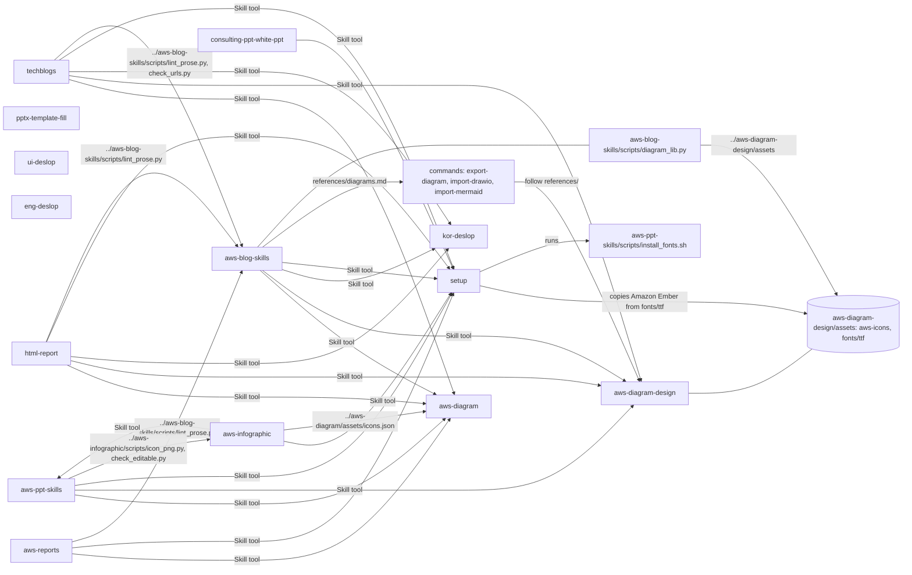
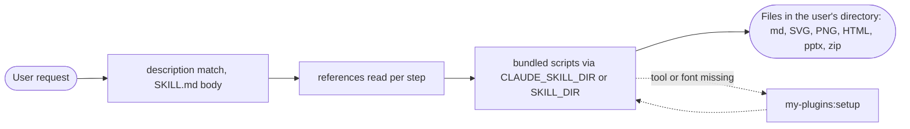

# Architecture

---

# English

## System Overview
`my-plugins` is one Claude Code plugin that bundles five earlier plugins by WooHyung Choi: aws-blog-skills
1.2.2, aws-diagrams 1.0.0, kor-writing 1.0.0, aws-deck 1.0.0 and aws-reports 1.0.0. It ships fourteen skills and five slash
commands. Each skill is Markdown instructions plus bundled Python, Bash or Node.js scripts that Claude runs on
the user's machine when the workflow calls for them. Skills call each other inside the plugin with the Skill
tool as `my-plugins:<skill>`, and reach each other's files only by paths relative to their own folder.
Output goes to the user's current directory, never into the plugin cache.

## Components

### Distribution Layer
- `.claude-plugin/marketplace.json` — marketplace `my-plugins` with one plugin entry, `"source": "./"`
- `.claude-plugin/plugin.json` — name, `version` (the update key for installed copies) and `license: MIT`;
  upstream parts and bundled templates, fonts and icons keep their own terms, see `NOTICE.md`
- GitHub `whchoi98/my-plugins` (public repo) — installers get the repo root in
  `~/.claude/plugins/cache/my-plugins/my-plugins/<version>/` and call skills as `/my-plugins:<skill>`

### AI/ML Layer: skills and commands
| Skill / command | Source | Role |
|---|---|---|
| `aws-blog-skills` | aws-blog-skills 1.2.2 | AWS Korea Tech Blog draft from source to zip, steps 0-8 (a scored pre-check before packaging, HTML for WordPress in the bundle), references per step |
| `aws-diagram` | aws-diagrams 1.0.0 | AWS architecture SVG with the official AWS and Bedrock AgentCore icon bundle |
| `aws-diagram-design` | cathrynlavery/diagram-design (MIT), AWS edition rebuilt by a recipe | Structure diagrams and charts in the source's visual types as HTML/SVG/PNG, with draw.io, Mermaid, Excalidraw and PlantUML import; holds the shared `assets/` |
| `kor-deslop` | kor-writing 1.0.0 | Korean AI-tell removal in one pass from an 81-pattern rulebook, content unchanged |
| `aws-ppt-skills` | aws-deck 1.0.0 | Seminar decks on the bundled 2026 black or white template with pptxgenjs, delivered as PowerPoint, as one HTML file presented in a browser, or both |
| `consulting-ppt-white-ppt` | aws-deck 1.0.0 | Dense, light consulting-report decks with a customer brand accent |
| `pptx-template-fill` | aws-deck 1.0.0 | Fills a user-supplied .pptx in place with python-pptx |
| `aws-reports` | aws-reports 1.0.0 | Benchmark and PoC result reports as MS Word + standalone HTML from one Markdown draft |
| `html-report` | new | One shareable HTML page in the common report design (bilingual, light and dark), filled from a fixed template and checked |
| `techblogs` | new | Posts for the author's personal tech blog: a bilingual report page and a front matter file built from work-folder fragments and a fixed template, checked, then placed into the blog repository |
| `aws-infographic` | new | Fact-checked technical infographics (16:9 dark and light SVG and PNG, 4:5 on request) and the same content as an editable PowerPoint deck built through aws-ppt-skills |
| `ui-deslop` | heydamir/unslop (CC BY 4.0), vendored | AI-slop removal for UI: audit, a direction taken from the product, ordered passes on an existing screen |
| `eng-deslop` | blader/humanizer (MIT), vendored | AI-slop removal for English text by the source's numbered patterns, content unchanged |
| `setup` | new | Checks and installs the external tools and fonts the other skills need |
| `commands/export-diagram.md`, `import-drawio.md`, `import-mermaid.md` | aws-diagrams 1.0.0 | Thin prompts that follow `skills/aws-diagram-design/references/` |

### Processing Layer: bundled scripts
- aws-blog-skills — `lint_prose.py`, `check_structure.py`, `check_urls.py`, `diagram_lib.py` +
  `example_diagrams.py`, `render_diagrams.py` (Playwright), `package_blog.sh`
- aws-diagram — `find_icon.py`, `embed.py` (inline icons as base64), `build_bundle.py` (maintainer)
- aws-diagram-design — from the source, copied byte for byte: `self_check.py`, `verify_geometry.py`, `drawio_extract.py`,
  `mermaid_extract.py`, `excalidraw_extract.py`, `plantuml_extract.py`, `export_svg.py`, `export_png.py`; the edition's own:
  `aws_check.py`, `build_aws_icons.py` (maintainer)
- aws-ppt-skills — `apply_template.py`, `check_deck.py`, `svg_to_png.py`, `install_fonts.sh`, `deck_to_html.py`, `preview_html_deck.py`
- consulting-ppt-white-ppt — `lib/consult_helpers.js`, `tools/extract_brand_color.py`, `fix_pptx.py`, `fix_notes.py`
- pptx-template-fill — `tfill.py`, `inventory.py`, `swap_font.py`, `qa_check.py`, `example_fill.py`
- aws-reports — `report.mjs` (Markdown to docx + HTML, Node.js), `check_report.py` (style contract, `--profile benchmark|poc`),
  `chart_style.py`, `fonts.py` (font subsets), `preview.py` (Playwright), `svg2png.py`
- html-report — `check_html.py` (design contract, `--dump-ko`), `embed_images.py` (images as data URIs, page folder
  only), `preview.py` (Playwright, four views)
- techblogs — `import_aws_post.py` (a published AWS blog post into a work folder), `build_post.py` (fragments into the
  template), `check_post.py` (design contract, `--dump-ko`, `--urls`), `place_post.py` (copy into the blog repository,
  `--build` for Jekyll, no git), `preview.py` (Playwright, the report page and the post page that embeds it)
- aws-infographic — `infokit.py` (SVG builder: palette, text metrics, components, icons), `buildkit.py` (render with
  Playwright, layout QA, text lint), `icon_png.py` (bundle icons as PNG for a deck), `check_editable.py` (a deck holds
  only text boxes, shapes, tables, charts and icon pictures; standard library)
- setup — `scripts/setup.sh` (check, `install`, `install --sudo`)

### Dependency Layer
- `skills/setup/scripts/setup.sh` checks uv, Playwright Chromium, Amazon Ember, Noto Sans CJK KR,
  NanumSquareOTF, D2Coding, pptxgenjs, python-pptx, lxml, Pillow, cairosvg, fonttools, LibreOffice, Poppler,
  rsvg-convert and the aws-reports packages (docx, marked, docx-preview, jszip, NanumSquareOTF Regular), and installs them into the user's home; system packages only with `--sudo`, through `sudo -n`
  ([runbook](runbooks/setup-dependencies.md))

### Security Layer
- `.claude/settings.json` deny list and empty attribution; `.claude/hooks/secret-scan.sh` (PreToolUse, exit 2)
- git `pre-commit` and `commit-msg` hooks from `scripts/install-hooks.sh`
- No hooks, agents, MCP servers or `bin/` ship at the root; `.mcp.json` stays empty
- aws-blog-skills step 0 treats source material and fetched pages as data, not instructions

### Quality Layer
- `tests/run-all.sh` with hook, secret-pattern, structure and shipped-script suites
- `claude plugin validate .`; `scripts/diagrams/` holds the aws-diagrams repo gates and fixtures

## Cross-Skill Calls

`kor-deslop`, `ui-deslop`, `eng-deslop` and `pptx-template-fill` call no other skill. `setup` reaches the two sibling folders through
`$SKILLS/aws-diagram-design/assets/fonts/ttf` and `$SKILLS/aws-ppt-skills/scripts/install_fonts.sh`, where
`$SKILLS` is two levels above its own script. Renaming or moving a skill breaks these links
(`skills/CLAUDE.md`).

## Diagram Asset Lookup
`find_assets()` in `skills/aws-blog-skills/scripts/diagram_lib.py` returns the first candidate that contains
`aws-icons/`:

1. `AWS_DIAGRAM_ASSETS` environment variable
2. `.aws-diagram-assets` next to the running `diagram_lib.py`. SKILL.md step 4 writes this pointer with
   `diagram_lib.py --assets` when it copies the library into `<workdir>/diagrams/`, because the copy no longer
   sits next to the sibling skill
3. The sibling skill `../../aws-diagram-design/assets`, relative to the script
4. Claude Code plugin caches `~/.claude/plugins/cache/*/my-plugins/*/skills/aws-diagram-design/assets`, then the
   same path for the old standalone `aws-diagrams`, each sorted by numeric version, newest first
5. claude.ai-synced copies `~/.claude/plugins/synced/*/*/skills/aws-diagram-design/assets` under the user's home
   and `/root`, newest modification first
6. claude.ai container paths `/mnt/skills/plugin-files/{my-plugins,aws-diagrams}/skills/aws-diagram-design/assets`

If none matches, it raises `FileNotFoundError` and asks for `AWS_DIAGRAM_ASSETS`.

## Data Flow Summary

## Packaging

| Path | Ships to installers | Loaded as plugin component | Notes |
|---|---|---|---|
| `.claude-plugin/` | yes | yes | Manifests |
| `skills/<name>/` (14 skills) | yes | yes | Description always, body and references on invoke |
| `commands/` | yes | yes | Five Markdown prompts of aws-diagram-design, written by the sync from the source's commands; the only root component directory |
| `.mcp.json` | yes | yes | Must stay `{"mcpServers": {}}` |
| `skills/CLAUDE.md` | yes | no | Module doc, outside any skill folder |
| `third_party/`, `LICENSE`, `NOTICE.md`, `README.md`, `CHANGELOG.md` | yes | no | Licenses and docs |
| `.claude/` | yes | no | Dev harness, active only when this repo is the working directory |
| `.github/workflows/` | yes | no | Weekly check of the vendored skills; it runs on GitHub, never on an installer's machine |
| `docs/`, `docs/diagrams/`, `scripts/`, `tests/`, `CLAUDE.md` | yes | no | Inert for installers |

The installed copy is about 26 MB, mostly the aws-ppt-skills templates and fonts (about 15 MB) and the
aws-diagram-design and aws-diagram icons and fonts (about 9 MB).

## Key Design Decisions
- **One plugin, one namespace** — four plugins merged so cross-skill calls resolve inside one install
  ([ADR-002](decisions/ADR-002-merge-four-plugins-into-one.md)).
- **Sibling-relative paths** — a skill reaches another skill's files by `../<skill>/...`; plugin-cache globs are
  only a fallback ([ADR-002](decisions/ADR-002-merge-four-plugins-into-one.md)).
- **Dependencies through `setup`** — one script checks and installs every external tool and font; sudo only on
  request ([runbook](runbooks/setup-dependencies.md)).
- **One report skill, two report types** — benchmark and PoC reports share one engine, one description and one
  checker profile switch; npm packages are global and `report.mjs` finds them itself
  ([ADR-003](decisions/ADR-003-one-report-skill-global-npm.md)).
- **HTML reports from a fixed template** — html-report copies `assets/template.html` and fills content only; the
  design spec, template and checker hold the same values, and Korean and English are element pairs in one file
  ([ADR-004](decisions/ADR-004-html-report-template-fill.md)).
- **Blog posts built from fragments** — techblogs writes `meta.json` and one body fragment per language, and
  `build_post.py` fills the skill's own template. That template keeps the names the blog's report layout depends on,
  so it is not shared with html-report ([ADR-005](decisions/ADR-005-techblogs-personal-blog-workflow.md)).
- **Infographic content rebuilt as an editable deck** — aws-infographic hands its content to aws-ppt-skills and
  rebuilds each section from text boxes, shapes, native tables, native charts and icon PNGs. The picture of the
  infographic never goes on a slide, and `check_editable.py` refuses a deck that has one
  ([ADR-006](decisions/ADR-006-infographic-editable-deck.md)).
- **HTML deck converted from the finished deck** — aws-ppt-skills asks for the output format first (PPT, HTML or
  both). The HTML deck is never authored: `deck_to_html.py` reads the final `.pptx` and writes one self-contained
  page with the slide content as HTML and SVG, the template chrome as pictures rendered by LibreOffice, subset
  fonts and the notes for a presenter view ([ADR-007](decisions/ADR-007-html-deck-converted-from-pptx.md)).
- **Vendored skills synced by pull request** — `ui-deslop` and `eng-deslop` are copies of heydamir/unslop and
  blader/humanizer at a pinned commit. `scripts/upstream-skills.json` records the source, the commit and a hash of
  every file; `sync_upstream_skills.py` writes the folders and replaces only the `name` and `description`. A weekly
  workflow opens a pull request when a source changed and never merges or releases
  ([ADR-008](decisions/ADR-008-vendored-skills-synced-by-pull-request.md)).
- **aws-diagram-design rebuilt from its source by a recipe** — the skill is the AWS edition of
  cathrynlavery/diagram-design. `scripts/upstream/aws-diagram-design/recipe.json` states what the edition changes
  (token replacements, anchored edits, the edition's own files), and `sync_upstream_skills.py` rebuilds the skill and
  the five commands from the source with it. A change the recipe does not cover is refused before anything is
  written. A second workflow runs every second week and opens a pull request or an issue
  ([ADR-009](decisions/ADR-009-derived-skill-rebuilt-by-recipe.md)).
- **The blog pre-check is part of aws-blog-skills and its gate is a script** — the six criteria, minimums and report
  layout follow comeddy/blog-precheck-plugin (MIT), measured with the skill's own check scripts.
  `check_gate.py` recomputes the verdict, `md_to_wordpress.py` writes the WordPress form, and `package_blog.sh`
  writes no zip without a gate report it accepts
  ([ADR-010](decisions/ADR-010-blog-precheck-adapted-into-aws-blog-skills.md)).
- **aws-blog-skills targets Claude Code** — `${CLAUDE_SKILL_DIR}` paths, a work folder, checks on the assembled
  bundle ([ADR-001](decisions/ADR-001-claude-code-skill-conventions.md)).
- **Scripts for mechanical rules** — banned words, structure, URLs, diagram geometry and deck lint are scripts
  with exit codes; the model keeps judgment calls.

## Operations
- Release: [docs/runbooks/release-plugin.md](runbooks/release-plugin.md)
- User dependencies: [docs/runbooks/setup-dependencies.md](runbooks/setup-dependencies.md)
- Vendored skills: [docs/runbooks/sync-upstream-skills.md](runbooks/sync-upstream-skills.md)
- Onboarding: [docs/onboarding.md](onboarding.md)

---

# 한국어

## 시스템 개요
`my-plugins`는 WooHyung Choi의 플러그인 다섯 개(aws-blog-skills 1.2.2, aws-diagrams 1.0.0, kor-writing 1.0.0, aws-deck 1.0.0, aws-reports 1.0.0)를 묶은 Claude Code 플러그인 하나입니다. skill 14개와 슬래시 command 5개를 배포합니다. 각 skill은 Markdown 지침과 함께 배포되는 Python, Bash, Node.js 스크립트로 이루어지며, 워크플로가 필요로 할 때 Claude가 사용자 머신에서 스크립트를 실행합니다. skill끼리는 플러그인 안에서 Skill 도구로 `my-plugins:<skill>`을 부르고, 다른 skill의 파일은 자기 폴더 기준 상대 경로로만 찾습니다. 결과물은 사용자의 현재 디렉터리에 만들며 플러그인 캐시에는 쓰지 않습니다.

## 구성 요소

### Distribution Layer
- `.claude-plugin/marketplace.json` — 마켓플레이스 `my-plugins`, 플러그인 항목 하나, `"source": "./"`
- `.claude-plugin/plugin.json` — 이름과 `version`(설치본 갱신 기준). `license`는 MIT이고, 원 저작물과 함께 든 템플릿, 폰트, 아이콘은 각자의 조건을 따릅니다(`NOTICE.md` 참고)
- GitHub `whchoi98/my-plugins`(공개 저장소) — 설치하면 저장소 루트가 `~/.claude/plugins/cache/my-plugins/my-plugins/<version>/`에 들어가고, skill은 `/my-plugins:<skill>`로 부릅니다

### AI/ML Layer: skill과 command
| skill / command | 출처 | 역할 |
|---|---|---|
| `aws-blog-skills` | aws-blog-skills 1.2.2 | 소재부터 zip까지 AWS Korea Tech Blog 원고. 0~8단계(패키징 전 사전 점검 채점, 번들에 WordPress용 HTML 포함), 단계별 참조 파일 |
| `aws-diagram` | aws-diagrams 1.0.0 | 공식 AWS 아이콘과 Bedrock AgentCore 아이콘 묶음으로 그리는 AWS 아키텍처 SVG |
| `aws-diagram-design` | cathrynlavery/diagram-design(MIT)의 AWS 판, 변환 규칙으로 다시 만듦 | 원본의 시각 유형으로 그리는 구조 다이어그램과 차트 HTML/SVG/PNG. draw.io, Mermaid, Excalidraw, PlantUML 가져오기. 공용 `assets/`를 가짐 |
| `kor-deslop` | kor-writing 1.0.0 | 패턴 81개 규칙집으로 한국어 AI 티를 한 번에 제거. 내용은 그대로 |
| `aws-ppt-skills` | aws-deck 1.0.0 | 포함된 2026 블랙·화이트 템플릿 위에 pptxgenjs로 만드는 세미나 덱. PowerPoint, 브라우저에서 발표하는 HTML 한 파일, 또는 둘 다로 전달 |
| `consulting-ppt-white-ppt` | aws-deck 1.0.0 | 고객 브랜드 색을 쓰는 밝은 고밀도 컨설팅 리포트 덱 |
| `pptx-template-fill` | aws-deck 1.0.0 | 사용자가 준 .pptx를 python-pptx로 제자리에서 채우기 |
| `aws-reports` | aws-reports 1.0.0 | Markdown 원고 하나로 만드는 벤치마크·PoC 결과 보고서(MS Word + 단일 HTML) |
| `html-report` | 신규 | 고정 템플릿을 채우고 검사하는 공통 디자인의 공유용 단일 HTML 보고서(한영 전환, 라이트와 다크) |
| `techblogs` | 신규 | 글쓴이 개인 기술 블로그에 올릴 글. 작업 폴더의 조각 파일과 고정 템플릿으로 한영 리포트 페이지와 front matter 파일을 빌드하고 검사한 뒤 블로그 저장소에 배치 |
| `aws-infographic` | 신규 | 사실 검증한 기술 인포그래픽(16:9 다크와 라이트 SVG, PNG, 요청하면 4:5)과 같은 내용을 aws-ppt-skills로 만든 편집 가능한 PowerPoint 덱 |
| `ui-deslop` | heydamir/unslop(CC BY 4.0)에서 가져옴 | 화면의 AI 슬롭 제거: 점검, 제품에서 정한 방향, 기존 화면에 정해진 순서로 수정 |
| `eng-deslop` | blader/humanizer(MIT)에서 가져옴 | 원본의 패턴 목록으로 영어 글의 AI 슬롭 제거. 내용은 그대로 |
| `setup` | 신규 | 다른 skill이 쓰는 외부 프로그램과 폰트 점검·설치 |
| `commands/export-diagram.md`, `import-drawio.md`, `import-mermaid.md` | aws-diagrams 1.0.0 | `skills/aws-diagram-design/references/`를 따르는 짧은 프롬프트 |

### Processing Layer: 함께 배포되는 스크립트
- aws-blog-skills — `lint_prose.py`, `check_structure.py`, `check_urls.py`, `diagram_lib.py` + `example_diagrams.py`, `render_diagrams.py`(Playwright), `package_blog.sh`
- aws-diagram — `find_icon.py`, `embed.py`(아이콘을 base64로 내장), `build_bundle.py`(관리자용)
- aws-diagram-design — 원본에서 바이트 그대로 복사한 것: `self_check.py`, `verify_geometry.py`, `drawio_extract.py`, `mermaid_extract.py`, `excalidraw_extract.py`, `plantuml_extract.py`, `export_svg.py`, `export_png.py`. AWS 판의 것: `aws_check.py`, `build_aws_icons.py`(관리자용)
- aws-ppt-skills — `apply_template.py`, `check_deck.py`, `svg_to_png.py`, `install_fonts.sh`, `deck_to_html.py`, `preview_html_deck.py`
- consulting-ppt-white-ppt — `lib/consult_helpers.js`, `tools/extract_brand_color.py`, `fix_pptx.py`, `fix_notes.py`
- pptx-template-fill — `tfill.py`, `inventory.py`, `swap_font.py`, `qa_check.py`, `example_fill.py`
- aws-reports — `report.mjs`(Markdown을 docx + HTML로, Node.js), `check_report.py`(스타일 계약, `--profile benchmark|poc`), `chart_style.py`, `fonts.py`(글꼴 부분집합), `preview.py`(Playwright), `svg2png.py`
- html-report — `check_html.py`(디자인 계약, `--dump-ko`), `embed_images.py`(그림을 data URI로, 페이지 폴더 안만), `preview.py`(Playwright, 화면 네 가지)
- techblogs — `import_aws_post.py`(게시된 AWS 블로그 글을 작업 폴더로), `build_post.py`(조각 파일을 템플릿에 채움), `check_post.py`(디자인 계약, `--dump-ko`, `--urls`), `place_post.py`(블로그 저장소에 복사, `--build`로 Jekyll 빌드, git 실행 없음), `preview.py`(Playwright, 리포트 페이지와 그 페이지를 넣은 글 페이지)
- aws-infographic — `infokit.py`(SVG 빌더: 팔레트, 글자 폭 측정, 컴포넌트, 아이콘), `buildkit.py`(Playwright 렌더, 레이아웃 QA, 문구 lint), `icon_png.py`(번들 아이콘을 덱용 PNG로), `check_editable.py`(덱이 텍스트 상자, 도형, 표, 차트, 아이콘 그림으로만 되어 있는지 검사, 표준 라이브러리)
- setup — `scripts/setup.sh`(점검, `install`, `install --sudo`)

### Dependency Layer
- `skills/setup/scripts/setup.sh`가 uv, Playwright Chromium, Amazon Ember, Noto Sans CJK KR, NanumSquareOTF, D2Coding, pptxgenjs, python-pptx, lxml, Pillow, cairosvg, fonttools, LibreOffice, Poppler, rsvg-convert와 aws-reports 패키지(docx, marked, docx-preview, jszip, NanumSquareOTF Regular)를 점검하고 사용자 홈에 설치합니다. 시스템 패키지는 `--sudo`를 줄 때만 `sudo -n`으로 설치합니다([런북](runbooks/setup-dependencies.md))

### Security Layer
- `.claude/settings.json` deny 목록과 비운 attribution, `.claude/hooks/secret-scan.sh`(PreToolUse, exit 2)
- `scripts/install-hooks.sh`가 설치하는 git `pre-commit`과 `commit-msg` 훅
- 루트에는 hooks, agents, MCP 서버, `bin/`을 배포하지 않고 `.mcp.json`은 비워 둡니다
- aws-blog-skills 0단계는 소재와 읽어 온 페이지를 지시가 아니라 데이터로 다룹니다

### Quality Layer
- 훅, 시크릿 패턴, 구조, 배포 스크립트 테스트를 묶은 `tests/run-all.sh`
- `claude plugin validate .`. `scripts/diagrams/`에는 aws-diagrams 저장소의 검사 스크립트와 fixture가 있습니다

## skill 사이의 호출

`kor-deslop`, `ui-deslop`, `eng-deslop`, `pptx-template-fill`은 다른 skill을 부르지 않습니다. `setup`은 자기 스크립트에서 두 단계 위인 `$SKILLS`를 기준으로 `$SKILLS/aws-diagram-design/assets/fonts/ttf`와 `$SKILLS/aws-ppt-skills/scripts/install_fonts.sh`를 찾습니다. skill 이름을 바꾸거나 옮기면 이 연결이 끊어집니다(`skills/CLAUDE.md`).

## 다이어그램 assets 탐색 순서
`skills/aws-blog-skills/scripts/diagram_lib.py`의 `find_assets()`는 `aws-icons/`가 들어 있는 첫 후보를 돌려줍니다.

1. 환경 변수 `AWS_DIAGRAM_ASSETS`
2. 실행 중인 `diagram_lib.py` 옆의 `.aws-diagram-assets`. SKILL.md 4단계가 라이브러리를 `<workdir>/diagrams/`로 복사할 때 `diagram_lib.py --assets`로 이 포인터를 씁니다. 사본은 옆 skill 곁에 있지 않기 때문입니다
3. 스크립트 기준 옆 skill `../../aws-diagram-design/assets`
4. Claude Code 플러그인 캐시 `~/.claude/plugins/cache/*/my-plugins/*/skills/aws-diagram-design/assets`, 그다음 예전 단독 플러그인 `aws-diagrams`의 같은 경로. 각각 버전을 숫자로 비교해 높은 순
5. 사용자 홈과 `/root` 아래의 claude.ai 동기화 사본 `~/.claude/plugins/synced/*/*/skills/aws-diagram-design/assets`, 최근 수정 순
6. claude.ai 컨테이너 경로 `/mnt/skills/plugin-files/{my-plugins,aws-diagrams}/skills/aws-diagram-design/assets`

모두 없으면 `FileNotFoundError`를 내고 `AWS_DIAGRAM_ASSETS`를 지정하라고 안내합니다.

## 데이터 흐름 요약

## 패키징

| 경로 | 설치자에게 배포 | 플러그인 구성 요소로 로드 | 비고 |
|---|---|---|---|
| `.claude-plugin/` | 예 | 예 | 매니페스트 |
| `skills/<name>/`(skill 14개) | 예 | 예 | description은 항상, 본문과 참조 파일은 호출할 때 |
| `commands/` | 예 | 예 | Markdown 프롬프트 3개. 루트의 유일한 구성 요소 폴더 |
| `.mcp.json` | 예 | 예 | `{"mcpServers": {}}` 유지 |
| `skills/CLAUDE.md` | 예 | 아니요 | 모듈 문서, skill 폴더 밖 |
| `third_party/`, `LICENSE`, `NOTICE.md`, `README.md`, `CHANGELOG.md` | 예 | 아니요 | 라이선스와 문서 |
| `.claude/` | 예 | 아니요 | 개발 하네스, 이 저장소가 작업 디렉터리일 때만 동작 |
| `.github/workflows/` | 예 | 아니요 | 가져온 skill의 주간 점검. GitHub에서만 실행되고 설치자의 머신에서는 실행되지 않음 |
| `docs/`, `docs/diagrams/`, `scripts/`, `tests/`, `CLAUDE.md` | 예 | 아니요 | 설치자에게는 동작하지 않음 |

설치본은 약 26 MB입니다. 대부분 aws-ppt-skills의 템플릿과 폰트(약 15 MB), aws-diagram-design과 aws-diagram의 아이콘과 폰트(약 9 MB)입니다.

## 주요 설계 결정
- **플러그인 하나, 이름 공간 하나** — 네 플러그인을 합쳐 skill 사이의 호출이 설치본 하나 안에서 풀리게 했습니다([ADR-002](decisions/ADR-002-merge-four-plugins-into-one.md)).
- **보고서 skill 하나, 보고서 유형 둘** — 벤치마크와 PoC 보고서가 변환기, description, 검사 프로필 전환을 함께 씁니다. npm 패키지는 전역에 두고 `report.mjs`가 직접 찾습니다([ADR-003](decisions/ADR-003-one-report-skill-global-npm.md)).
- **고정 템플릿으로 만드는 HTML 보고서** — html-report는 `assets/template.html`을 복사해 내용만 채웁니다. 디자인 규격, 템플릿, 검사기가 같은 값을 갖고, 한국어와 영어는 한 파일 안의 요소 짝입니다([ADR-004](decisions/ADR-004-html-report-template-fill.md)).
- **조각 파일로 빌드하는 블로그 글** — techblogs는 `meta.json`과 언어별 본문 조각을 쓰고 `build_post.py`가 skill의 템플릿에 채웁니다. 이 템플릿은 블로그의 report 레이아웃이 의존하는 이름을 유지해야 하므로 html-report와 공유하지 않습니다([ADR-005](decisions/ADR-005-techblogs-personal-blog-workflow.md)).
- **인포그래픽 내용을 편집 가능한 덱으로 다시 만들기** — aws-infographic은 내용을 aws-ppt-skills에 넘겨 섹션마다 텍스트 상자, 도형, 표, 차트, 아이콘 PNG로 다시 만듭니다. 인포그래픽 그림은 슬라이드에 넣지 않고, 그림이 들어간 덱은 `check_editable.py`가 거부합니다([ADR-006](decisions/ADR-006-infographic-editable-deck.md)).
- **완성한 덱을 변환해 만드는 HTML 덱** — aws-ppt-skills는 출력 형식(PPT, HTML, 둘 다)을 먼저 묻습니다. HTML 덱은 따로 작성하지 않습니다. `deck_to_html.py`가 최종 `.pptx`를 읽어 한 파일짜리 페이지를 만듭니다. 슬라이드 내용은 HTML과 SVG로, 템플릿의 배경과 로고는 LibreOffice가 그린 그림으로 들어가고, 글꼴은 쓰인 글자만 포함하며, 노트는 발표자 보기에 나옵니다([ADR-007](decisions/ADR-007-html-deck-converted-from-pptx.md)).
- **가져온 skill은 pull request로 동기화** — `ui-deslop`과 `eng-deslop`은 heydamir/unslop과 blader/humanizer를 고정한 커밋에서 복사한 것입니다. `scripts/upstream-skills.json`이 원본, 커밋, 파일별 해시를 기록하고, `sync_upstream_skills.py`가 폴더를 쓰면서 `name`과 `description`만 바꿉니다. 주간 워크플로는 원본이 바뀌면 pull request를 열 뿐 병합하거나 릴리스하지 않습니다([ADR-008](decisions/ADR-008-vendored-skills-synced-by-pull-request.md)).
- **aws-diagram-design은 변환 규칙으로 원본에서 다시 만듦** — 이 skill은 cathrynlavery/diagram-design의 AWS 판입니다. `scripts/upstream/aws-diagram-design/recipe.json`이 AWS 판에서 바꾸는 내용(토큰 치환, 원본 문장을 기준으로 한 편집, AWS 판의 파일)을 적고, `sync_upstream_skills.py`가 이 규칙으로 skill과 command 5개를 원본에서 다시 만듭니다. 변환 규칙이 다루지 않는 변경은 쓰기 전에 거부합니다. 두 번째 워크플로가 2주에 한 번 실행되어 pull request나 issue를 엽니다([ADR-009](decisions/ADR-009-derived-skill-rebuilt-by-recipe.md)).
- **블로그 사전 점검은 aws-blog-skills 안에 두고 게이트는 스크립트가 판정** — 여섯 기준, 최저선, 리포트 형식은 comeddy/blog-precheck-plugin(MIT)을 따르고, 측정은 이 skill의 검사 스크립트로 합니다. `check_gate.py`가 판정을 다시 계산하고, `md_to_wordpress.py`가 WordPress 형식을 만들며, `package_blog.sh`는 통과한 게이트 리포트가 없으면 zip을 만들지 않습니다([ADR-010](decisions/ADR-010-blog-precheck-adapted-into-aws-blog-skills.md)).
- **옆 skill 기준 상대 경로** — 다른 skill의 파일은 `../<skill>/...`로 찾고, 플러그인 캐시 glob은 대비책으로만 씁니다([ADR-002](decisions/ADR-002-merge-four-plugins-into-one.md)).
- **의존 프로그램은 `setup`으로** — 스크립트 하나가 모든 외부 프로그램과 폰트를 점검하고 설치하며, sudo는 요청할 때만 씁니다([런북](runbooks/setup-dependencies.md)).
- **aws-blog-skills는 Claude Code 대상** — `${CLAUDE_SKILL_DIR}` 경로, 작업 폴더, 조립한 번들 검사([ADR-001](decisions/ADR-001-claude-code-skill-conventions.md)).
- **기계적 규칙은 스크립트로** — 금지어, 구조, URL, 다이어그램 기하, 덱 lint는 종료 코드가 있는 스크립트로 두고, 모델은 판단만 맡습니다.

## 운영
- 릴리스: [docs/runbooks/release-plugin.md](runbooks/release-plugin.md)
- 사용자 의존 프로그램: [docs/runbooks/setup-dependencies.md](runbooks/setup-dependencies.md)
- 가져온 skill 동기화: [docs/runbooks/sync-upstream-skills.md](runbooks/sync-upstream-skills.md)
- 온보딩: [docs/onboarding.md](onboarding.md)
