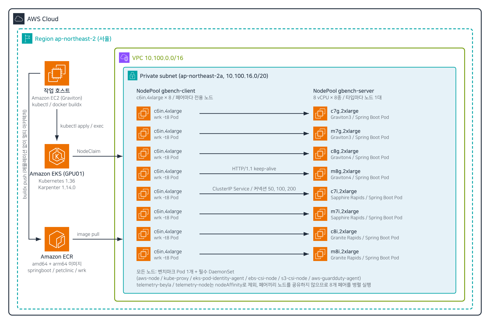
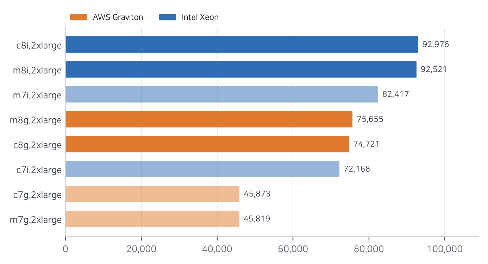
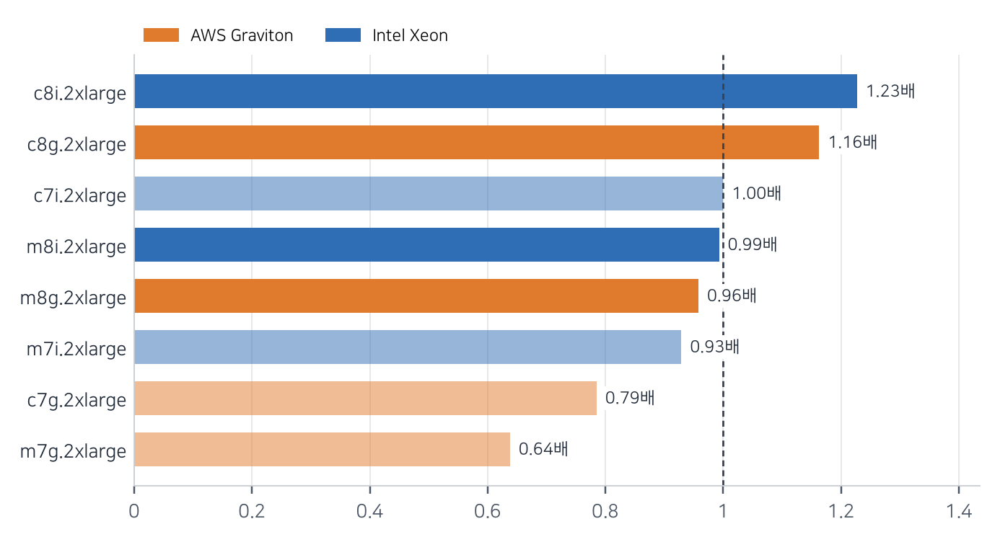
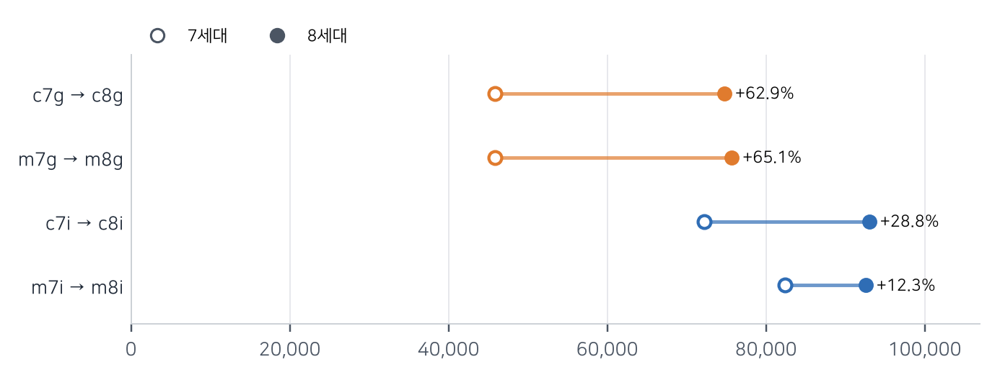
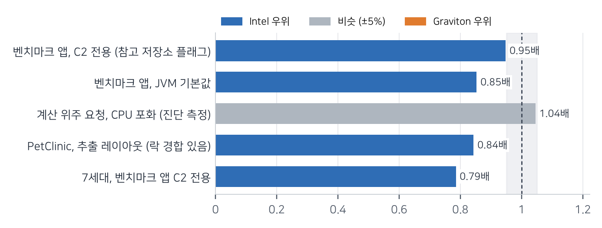

AWS Graviton 기반 c7g, m7g, c8g, m8g와 Intel Xeon 기반 c7i, m7i, c8i, m8i의 2xlarge 인스턴스를 비교했습니다. 같은 Spring Boot 애플리케이션을 Amazon EKS 노드마다 하나씩 띄우고, 노드마다 전용 부하 발생기를 붙여 서로 영향을 주지 않게 측정했습니다.

**On-Demand 가격 기준으로 Spring Boot에서는 Intel 8세대인 c8i.2xlarge의 가격 대비 성능이 가장 좋았습니다. Graviton4 기반 c8g.2xlarge는 시간당 가격이 c8i.2xlarge의 0.85배이지만 처리량이 그보다 더 낮았습니다.**

| 항목 | 결과 | 비고 |
|---|---|---|
| 종합 처리량 1위 | c8i.2xlarge | c7i.2xlarge 대비 1.29배 |
| 가격 대비 성능 1위 | c8i.2xlarge | c7i.2xlarge 대비 1.23배 |
| Graviton3 → Graviton4 | +62.9% | c7g → c8g, 가격은 +10% |
| c8g / c8i 가격 대비 성능 | 0.95배 | C2 전용 프로파일 |

표: 핵심 결과

## 측정 환경과 방법 {#method}



Karpenter NodePool 두 개(`gbench-server`, `gbench-client`)가 한 가용 영역의 Private subnet에 노드를 프로비저닝했습니다. `podAntiAffinity`로 노드마다 벤치마크 Pod를 하나만 배치해, 8개 페어를 동시에 실행해도 노드를 공유하지 않습니다.

> **벤치마크 노드: 필수 DaemonSet만 유지**
>
> 관측 에이전트 `telemetry-beyla`와 `telemetry-node`는 모든 taint를 허용합니다. 그래서 nodeAffinity(`graviton-bench/role DoesNotExist`)를 추가해 벤치마크 노드에서 제외했습니다.
>
> - 남은 DaemonSet: aws-node, kube-proxy, eks-pod-identity-agent, ebs-csi-node

> **첫 측정 폐기: Tomcat keep-alive 기본값**
>
> Tomcat 기본값(`server.tomcat.max-keep-alive-requests=100`)은 요청 100건마다 연결을 끊습니다. 클라이언트에 TIME_WAIT 소켓이 쌓여 임시 포트가 고갈됐고, 처리량이 높은 인스턴스일수록 값이 낮게 나왔습니다.

| 인스턴스 | 프로세서 | vCPU | 메모리 (GiB) | 시간당 가격 |
|---|---|---:|---:|---:|
| c7g.2xlarge | Graviton3 | 8 | 16 | $0.3264 |
| c8g.2xlarge | Graviton4 | 8 | 16 | $0.3590 |
| c7i.2xlarge | Sapphire Rapids | 8 | 16 | $0.4032 |
| c8i.2xlarge | Granite Rapids | 8 | 16 | $0.4234 |

표: 측정 대상 인스턴스 (일부)

주: 서울 리전 On-Demand Linux 가격입니다.

```bash
wrk -t8 -c200 -d60s --latency http://sb-c8g:8080/json
```

<!-- pagebreak -->
## 종합 처리량



주: 세 엔드포인트 최대 처리량의 기하평균입니다. 흐린 막대는 7세대입니다.

c8i.2xlarge가 92,976 요청/초로 가장 높았고, Graviton4 두 타입은 7세대 Intel과 비슷한 수준이었습니다. 처리량 차이는 코어 수가 아니라 코어당 속도에서 나왔습니다. 모든 인스턴스가 8 vCPU이기 때문입니다.

## 가격 대비 성능



주: 종합 처리량 ÷ 시간당 가격을 c7i.2xlarge = 1.00으로 나눈 값입니다.

c8g.2xlarge는 가격이 낮아 처리량 순위보다 가격 대비 성능 순위가 높습니다. 그래도 c8i.2xlarge의 1.23배에는 미치지 못했습니다.

## 세대 간 향상



Graviton3에서 Graviton4로 바뀌며 처리량이 63% 늘었고, 시간당 가격은 10% 올랐습니다. Intel은 Sapphire Rapids에서 Granite Rapids로 바뀌며 c 패밀리가 29% 늘었습니다.

<!-- pagebreak -->
## 종합 평가: Spring Boot에서 가격 대비 성능이 좋은 선택 {#verdict}

이번 측정의 목적은 Spring Boot 워크로드에서 Graviton과 Intel 중 어느 쪽의 가격 대비 성능이 좋은지 판단하는 것입니다. 서울 리전 On-Demand 가격 기준으로는 c8i.2xlarge가 대부분의 시나리오에서 앞섰습니다.



주: 1.00보다 크면 Graviton이 유리합니다. ±5% 안은 비슷한 것으로 봅니다.

> **결과를 해석할 때 유의할 점**
>
> - 한 가용 영역, 한 리전, On-Demand 가격 기준입니다. Savings Plans 할인율이 다르면 비율이 달라집니다.
> - PetClinic은 클래스 로더의 락 경합 때문에 CPU를 모두 쓰지 못했습니다.

> **권고**
>
> - Spring Boot API 서버를 새로 배치한다면 c8i.2xlarge부터 검토합니다.
> - c8g.2xlarge는 요청 처리 대부분이 CPU 집약적인 로직일 때 대안이 됩니다. 실제 요청 구성으로 측정하고, 스레드 덤프로 락 경합이 없는지 확인한 뒤 결정합니다.
> - 7세대를 쓰고 있다면 같은 아키텍처의 8세대로 옮기는 것만으로 처리량이 13~65% 늘어납니다.
