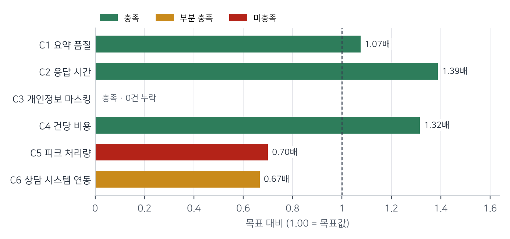
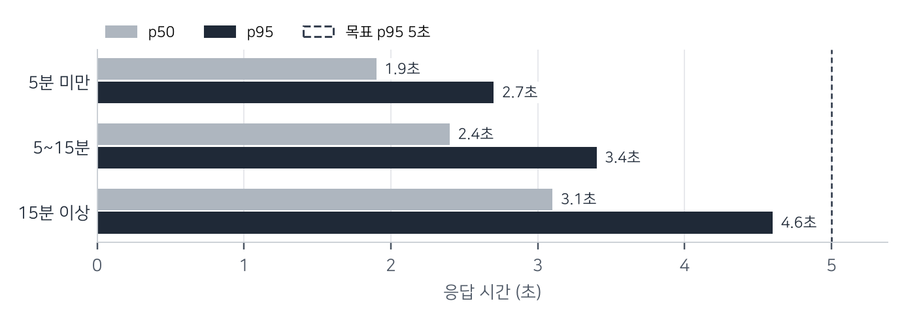

상담이 끝나면 상담사가 직접 쓰던 상담 요약을 Amazon Bedrock의 Claude 모델로 자동 작성할 수 있는지 3주 동안 검증했습니다. 고객사와 미리 합의한 성공 기준 6개(필수 5개, 선택 1개)를 실제 상담 녹취 전사본으로 측정했습니다.

**판정은 조건부 진행입니다. 필수 기준 5개 중 4개를 충족했고, 피크 처리량 1개는 미충족입니다. 처리량은 모델 성능이 아니라 계정의 분당 토큰 할당량에서 막혔으므로, 할당량을 늘린 뒤 다시 측정해 충족하면 파일럿으로 넘어가기를 권고합니다.**

| 성공 기준 | 목표 | 결과 | 판정 |
|---|---|---|---|
| C1 요약 품질 | 평균 4.0점 이상 | 4.3점 | 충족 |
| C2 응답 시간 | p95 5초 이하 | p95 3.6초 | 충족 |
| C3 개인정보 마스킹 | 누락 0건 | 0건 (1차 측정 2건) | 충족 (조치 후 재측정) |
| C4 건당 비용 | $0.005 이하 | $0.0038 | 충족 |
| C5 피크 처리량 | 시간당 3,000건 | 시간당 2,100건 | 미충족 |
| C6 상담 시스템 연동 (선택) | 3개 채널 | 2개 채널 | 부분 충족 |

표: 성공 기준별 판정 요약

## PoC 개요 {#overview}

고객사 콜센터는 하루 약 1만 건의 상담을 처리하고, 상담사는 상담이 끝날 때마다 평균 90초를 들여 요약을 씁니다. 이 PoC는 자동 요약이 상담사가 쓴 요약을 대신할 만큼 정확하고, 콜센터 피크 시간의 양을 감당하며, 개인정보를 남기지 않는지 확인해 도입 여부를 결정하기 위해 진행했습니다.

| 구분 | 포함 | 제외 |
|---|---|---|
| 데이터 | 2026년 9월 상담 녹취 전사본 1,500건(개인정보 포함 원본) | 음성 인식(STT) 품질, 실시간 통화 중 요약 |
| 채널 | 전화, 채팅, 이메일 상담 | 상담 외 업무 메모 |
| 측정 | 요약 품질, 응답 시간, 마스킹, 비용, 처리량, CRM 연동 | 장애 조치, 다중 리전 구성 |

표: PoC 범위

| 단계 | 기간 | 내용 |
|---|---|---|
| 준비 | 10월 6일~10월 10일 | 성공 기준 합의, 계정과 데이터 준비, 프롬프트 초안 |
| 구축 | 10월 13일~10월 17일 | 요약 파이프라인, 마스킹, CRM 연동 |
| 측정 | 10월 20일~10월 24일 | 기준별 측정, 결과 검토 |

표: 일정

| 조직 | 역할 |
|---|---|
| 고객사 상담운영팀 | 성공 기준 합의, 요약 품질 평가(상담사 3명) |
| 고객사 IT팀 | 계정, 네트워크, CRM API 권한 |
| AWS 솔루션즈 아키텍트 | 아키텍처, 파이프라인 구축, 측정과 보고서 |

표: 참여 조직과 역할

## 성공 기준 {#criteria}

성공 기준은 측정을 시작하기 전인 10월 8일 상담운영팀, IT팀과 함께 정했습니다. 필수 기준을 모두 충족하면 진행, 필수 기준의 미충족이 조치로 해결될 수 있으면 조건부 진행, 해결할 방법이 없으면 보류로 판정하기로 했습니다.

| 번호 | 성공 기준 | 구분 | 목표 | 측정 방법 |
|---|---|---|---|---|
| C1 | 요약 품질 | 필수 | 평균 4.0점 이상 (5점 척도) | 상담 200건을 상담사 3명이 블라인드로 평가 |
| C2 | 응답 시간 | 필수 | p95 5초 이하 | 통화 종료부터 요약 저장까지, 상담 1,000건 |
| C3 | 개인정보 마스킹 | 필수 | 누락 0건 | 테스트 세트 300건(주민등록번호, 전화번호, 계좌번호, 카드번호) |
| C4 | 건당 비용 | 필수 | $0.005 이하 | 실측 입력·출력 토큰 × 서울 리전 On-Demand 가격 |
| C5 | 피크 처리량 | 필수 | 시간당 3,000건 | 상담 종료 이벤트를 재생해 30분 유지 |
| C6 | 상담 시스템 연동 | 선택 | 3개 채널 | 전화, 채팅, 이메일 채널에서 CRM API로 요약 저장 |

표: 성공 기준과 측정 방법

주: 시간당 3,000건은 지난 6개월 피크 시간 상담량의 1.2배입니다.

## 구성과 방법 {#method}

상담이 끝나면 CRM이 종료 이벤트를 보내고, AWS Lambda 함수가 전사본을 가져와 개인정보를 가린 뒤 Amazon Bedrock으로 요약을 만들어 CRM에 저장합니다. 개인정보는 모델에 보내기 전에 Amazon Bedrock Guardrails의 민감 정보 필터와 정규식으로 가립니다.

| 항목 | 값 |
|---|---|
| 모델 | Amazon Bedrock, Claude 모델(On-Demand) |
| 실행 환경 | AWS Lambda(Python 3.13, 메모리 1,024 MB), Amazon API Gateway |
| 개인정보 처리 | Amazon Bedrock Guardrails 민감 정보 필터 + 정규식 4종 |
| 저장 | 원문과 요약 Amazon S3(SSE-KMS), 요약은 CRM API로 저장 |
| 부하 도구 | 상담 종료 이벤트 재생 스크립트(Amazon EC2 c7g.xlarge 1대) |

표: 측정 환경

> **측정 데이터: 실제 상담 전사본 사용**
>
> 개인정보가 포함된 원본 전사본을 쓰기 위해 고객사 계정 안에서만 처리했습니다. 전사본과 요약은 PoC가 끝난 10월 24일에 모두 삭제했습니다.

<!-- pagebreak -->
## 기준별 결과 {#results}

필수 기준 5개 중 4개를 충족했습니다. 목표 대비 비율로 보면 응답 시간과 비용은 목표보다 30% 이상 여유가 있고, 피크 처리량만 목표에 못 미쳤습니다.

주: 응답 시간과 비용은 목표값 ÷ 결과, 나머지는 결과 ÷ 목표값입니다. 1.00을 넘으면 목표를 충족합니다.

### C1 요약 품질: 충족

상담사 3명이 상담 200건의 요약을 원문과 대조해 5점 척도로 평가했고 평균은 4.3점이었습니다. 3점 이하를 받은 요약 11건 중 8건은 상담 도중 고객의 요청이 바뀐 경우로, 바뀌기 전 요청을 요약에 남겼습니다.

### C2 응답 시간: 충족

상담 1,000건의 p95는 3.6초로 목표 5초보다 짧았습니다. 상담이 길수록 응답 시간이 늘지만 15분 이상 상담에서도 p95가 4.6초였습니다.

주: 통화 종료 이벤트 수신부터 CRM 저장 완료까지입니다.

### C3 개인정보 마스킹: 충족 (조치 후 재측정)

1차 측정에서 테스트 세트 300건 중 2건의 계좌번호가 가려지지 않았습니다. 두 건 모두 하이픈 없이 붙여 쓴 13자리 숫자였습니다. 정규식을 추가한 뒤 300건 전체를 다시 측정해 누락 0건을 확인했습니다.

### C4 건당 비용: 충족

상담 1건의 평균 입력은 2,850토큰, 출력은 310토큰이었고, 서울 리전 On-Demand 가격으로 건당 $0.0038입니다. 목표 $0.005의 0.76배입니다.

### C5 피크 처리량: 미충족

시간당 2,100건을 넘기면 Amazon Bedrock이 `ThrottlingException`을 반환해 목표 3,000건에 못 미쳤습니다. 오류가 난 시점의 처리량은 계정의 분당 토큰 할당량과 일치했고, Lambda 동시 실행과 응답 시간에는 여유가 있었습니다. 할당량 증설을 요청했고, 승인되면 같은 방법으로 다시 측정합니다.

### C6 상담 시스템 연동: 부분 충족

전화와 채팅 채널은 CRM API로 요약을 저장하는 것까지 확인했습니다. 이메일 채널은 CRM API 쓰기 권한이 PoC 기간 안에 발급되지 않아 시험하지 못했습니다.

## 이슈와 조치 {#issues}

| 번호 | 이슈 | 원인 | 조치 | 상태 |
|---|---|---|---|---|
| I1 | 계좌번호 마스킹 누락 2건 | 하이픈 없는 13자리 숫자를 정규식이 놓침 | 정규식 추가, 300건 재측정 | 해결 |
| I2 | 피크 부하에서 스로틀링 | 계정의 분당 토큰 할당량 | 할당량 증설 요청 | 진행 중 |
| I3 | 이메일 채널 미연동 | CRM API 쓰기 권한 미발급 | 고객사 IT팀 권한 발급 | 미해결 |
| I4 | 바뀐 요청을 요약에 남김 | 프롬프트가 상담의 마지막 요청을 구분하지 않음 | 프롬프트에 최종 요청 항목 추가, 파일럿에서 재평가 | 진행 중 |

표: 이슈와 조치

## 비용 {#cost}

| 항목 | PoC 실제 비용 (USD) | 운영 예상 월 비용 (USD) | 가정 |
|---|---:|---:|---|
| Amazon Bedrock 모델 호출 | 41 | 1,140 | 월 30만 건 × 건당 $0.0038 |
| AWS Lambda, Amazon API Gateway | 3 | 85 | 월 30만 건 |
| Amazon S3, Amazon CloudWatch | 2 | 40 | 요약 90일 보관 |
| 합계 | 46 | 1,265 | |

표: PoC 비용과 운영 예상 비용

주: 서울 리전 On-Demand 가격(2026년 10월) 기준이고 세금은 포함하지 않았습니다.

<!-- pagebreak -->
## 종합 평가와 다음 단계 {#verdict}

자동 요약은 품질, 응답 시간, 마스킹, 비용에서 도입 기준을 충족했습니다. 남은 필수 기준인 피크 처리량은 할당량을 늘리면 해결될 가능성이 높지만 아직 측정으로 확인하지 못했으므로, 판정은 조건부 진행입니다.

| 성공 기준 | 판정 | 근거 | 후속 조치 |
|---|---|---|---|
| C1 요약 품질 | 충족 | 평균 4.3점 | 파일럿에서 I4 조치 후 재평가 |
| C2 응답 시간 | 충족 | p95 3.6초 | 없음 |
| C3 개인정보 마스킹 | 충족 (조치 후 재측정) | 재측정 누락 0건 | 운영 전 정규식 목록 고객사 보안팀 검토 |
| C4 건당 비용 | 충족 | 건당 $0.0038 | 없음 |
| C5 피크 처리량 | 미충족 | 시간당 2,100건 | 할당량 증설 후 재측정 |
| C6 상담 시스템 연동 | 부분 충족 | 3개 채널 중 2개 | 이메일 채널 권한 발급 후 시험 |

표: 성공 기준별 판정과 후속 조치

> **권고**
>
> - 할당량 증설이 승인되면 피크 처리량을 같은 방법으로 다시 측정하고, 시간당 3,000건을 넘으면 파일럿을 시작합니다.
> - 파일럿은 상담사 20명, 4주로 시작하고, 상담사가 요약을 고친 비율을 주간으로 봅니다.
> - 피크 시간이 더 늘어날 계획이 있으면 On-Demand 할당량 대신 프로비저닝된 처리량의 비용을 함께 비교합니다.
> - 개인정보 정규식은 코드와 함께 버전을 관리하고, 새 형식을 발견할 때마다 테스트 세트에 추가합니다.

> **운영 전환 시 고려 사항**
>
> - 모델 버전을 고정하고, 버전을 바꿀 때는 이번 평가 세트 200건으로 품질을 다시 확인합니다.
> - 요약 실패 시 상담사가 직접 작성하도록 CRM 화면에 대체 경로를 둡니다.

| 단계 | 내용 | 담당 | 시기 |
|---|---|---|---|
| 1 | 할당량 증설 후 피크 처리량 재측정 | AWS 솔루션즈 아키텍트, 고객사 IT팀 | 11월 둘째 주 |
| 2 | 이메일 채널 연동 시험 | 고객사 IT팀 | 11월 셋째 주 |
| 3 | 파일럿(상담사 20명, 4주) | 고객사 상담운영팀 | 12월 |

표: 다음 단계
